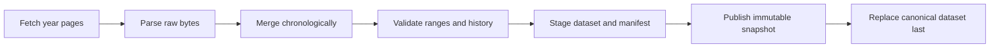

# 資料管線與操作方式

本文件說明 Lottery ML Portfolio 如何從公開歷史網頁建立可追溯、防竄改的標準資料集（Canonical Dataset）。關鍵技術名詞保留英文，解說採用繁體中文與台灣慣用技術語彙。

## 資料來源

- 年份索引：`https://www.nfd.com.tw/lottery/lottyear/year.htm`
- 年度頁面：`https://www.nfd.com.tw/lottery/power-38/{year}.htm`
- 歷史資料回補起始年：2008

NFD 頁面採用 Big5 編碼，表格欄位包含「年份、日期、期數、球號 1–6、特號、總期數」。解析器（Parser）會依據表頭名稱動態建立欄位對應，而不依賴脆弱的固定欄位索引。測試樣本（Fixtures）僅保留少量真實資料列與必要的 HTML 結構，並完整記錄來源網址與擷取日期。

## 管線流程（Pipeline Flow）



每次執行資料匯入（Ingestion）時，系統會先抓完並解析所有指定年份的頁面，通過檢查後才開始寫入檔案。只要其中任何一頁擷取或解析失敗，現有的標準資料集、快照與清單都維持原狀，不會被半途覆寫。

## 資料檢核關卡（Validation Gates）

1. 第一區必須正好為 6 個不重複的整數，且落於 1–38 之間。
2. 第二區必須落於 1–8 之間。
3. 開獎日期（Draw Date）必須嚴格遞增，期數編號（Draw ID）不得重複。
4. 既有的歷史開獎紀錄不得無故消失。
5. 既有開獎紀錄的數值不得改變，除非在勘誤表（Correction Registry）中有完全吻合的舊值與新值紀錄。
6. 勘誤表中不允許存在未被觸發的閒置規則，避免例外條件無止境累積。
7. 待發布的資料集不得為空。
8. 快照與資料清單路徑不得覆寫既有檔案。

## 勘誤機制（Correction Registries）

來源網頁筆誤與已發布歷史紀錄的變更分屬兩種不同風險，因此管線將兩者拆分為獨立的勘誤設定檔管理。

### 來源筆誤勘誤（Source Corrections）

位置：`configs/data/source-corrections.json`

經過交叉核對的來源網站筆誤，必須透過 `draw_id`、`field`、`old`、`new` 進行精確比對，不在解析器程式碼裡寫死特定日期的條件分支。每筆勘誤都必須附上修正理由與獨立的第三方新聞來源。如果未來來源網站自行修正了該筆筆誤，導致規則不再匹配，該條規則就會被標記為未使用的例外，使當次匯入自動中止並提醒人工複查。

目前勘誤表僅記錄一筆：NFD 在 `2025-10-09` 將第二區球號誤植為不可能出現的 `28`；經比對 [TVBS](https://news.tvbs.com.tw/life/3011821) 與 [中央社／經濟日報](https://money.udn.com/money/story/122328/9060934) 報導，當期第二區實為 `08`。所有套用的勘誤編號皆會寫入當次的 Manifest 清單中。

### 歷史變更勘誤（Historical Corrections）

位置：`configs/data/corrections.json`

若來源網站在事後改動了已經發布過的歷史紀錄，管線預設會拒絕更新；必須先由人工比對可信來源，再新增一筆包含下列資訊的勘誤紀錄：

- `draw_id`
- 完整的 `old` 紀錄
- 完整的 `new` 紀錄
- `reason`（修正原因）
- 可查證的 `source`（佐證來源）

歷史變更勘誤僅允許精確匹配一次。完成發布後，Manifest 的 `corrections_applied` 會留下稽核紀錄；該筆規則應於下一次例行匯入前移除，並由 Git 版本歷史永久保存變更軌跡。

## 不可改動快照契約（Immutable Snapshot Contract）

```text
data/raw/snapshots/<YYYYMMDDTHHMMSS+0800>/power-lottery.json
data/manifests/<YYYYMMDDTHHMMSS+0800>.json
data/processed/power-lottery.json
```

每份 Snapshot 都是當次驗證通過資料集的完整備份。Manifest 則記錄：

- `schema_version`
- `fetched_at`
- `source_urls`
- 標準資料集位元組的 `sha256` 指紋
- `draw_count`
- `date_min`／`date_max`
- `validation_status`
- `corrections_applied`
- `git_commit`

所有檔案會先寫入暫存區（Staging Directory）並重新讀取驗證。正式發布的順序固定為：先寫入 Snapshot、再寫入 Manifest，最後才以原子化替換（Atomic Replace）更新標準資料集。若在最後一步之前發生任何錯誤，當次建立的 Snapshot 與 Manifest 都會自動回滾清除。

## 本機操作指令

初次完整回補：

```powershell
lottery-ml ingest --from-year 2008 --through-year 2026 --root .
```

例行排程匯入同樣會重新讀取完整年份區間，藉此驗證過往的歷史紀錄沒有被來源網站悄悄刪減或改寫。

執行成功時會輸出一行 JSON 摘要：

```json
{"manifest_path":"...","sha256":"...","snapshot_path":"...","status":"published"}
```

若資料內容與上一版完全相同，`status` 會顯示為 `unchanged`，兩個路徑欄位則為 `null`。

## 異常處理行為（Failure Behavior）

- 網路逾時或 HTTP 狀態異常：不寫入任何檔案，僅於 `stderr` 輸出安全摘要。
- 網頁表格結構改變（Schema Drift）：解析器立即中止（Fail Closed），不盲目猜測欄位位置。
- 歷史紀錄遭到竄改：除非與勘誤表精確吻合，否則一律拒絕發布。
- 寫入或替換失敗：完整保留上一版標準資料集。

## 自動化排程邊界

GitHub Actions 於台灣時間每週二、週五 09:17（並於 12:17 複檢）自動執行資料匯入，同時支援手動觸發（`workflow_dispatch`）。本機與 CI 環境共用同一套 CLI 程式，不維護兩套獨立的匯入邏輯。
