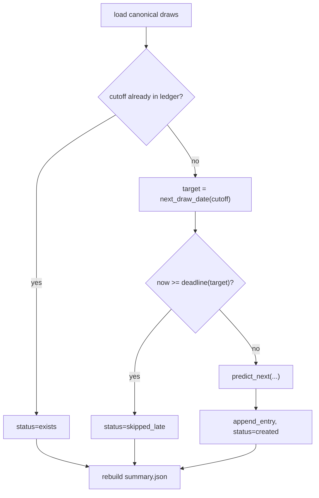

# Spec：Forward Test Ledger＋網站數值去寫死＋Baseline 命名修正

> 狀態：Draft v2 · 2026-11-04（v1 → v2：ledger 改單一檔案、新增 Part B / Part C）
> 對象：實作此功能的 coding agent
> 範圍：Python CLI、GitHub Actions、Next.js 網站、文件

本 spec 分三部分，建議依序實作（§D 有完整順序）：

- **Part A**：Forward Test Ledger（前瞻盲測紀錄）：每次開獎資料更新後，產生下一期預測並自動計分。
- **Part B**：`rolling_frequency` baseline 命名修正：名稱和實作不符。
- **Part C**：網站寫死數值清查與修正：所有展示數字與敘述結論都要從 artifacts / configs / dataset 推導。

已確認的決策：
- 新增週二、週五 09:00（Taipei）補抓排程。
- 首頁卡片放在「最重要的研究結論」區塊下方。
- 威力彩開獎日為週一、週四，約 20:30。

---

# Part A：Forward Test Ledger

## A0. 一句話目標

每次 `Update verified lottery data` 抓到新的一期開獎、驗證成功並提交後，用**已凍結的 `selection-v1` protocol** 對**下一期**產生一筆**不可改寫**的預測紀錄。等那一期開出來後自動計分，網站同時顯示「下一期預測」和「累積前瞻成績 vs 隨機期望值」。

這是 locked holdout 之後的**第二次、真正事前（ex-ante）的 out-of-sample 評估**，不是明牌功能。所有文案都要照這個定位寫。

## A1. 設計決策紀錄

| 議題 | 決策 | 原因 |
|---|---|---|
| 模型來源 | 不存模型檔。每期用到 cutoff 為止的全部資料，依 `selection-v1.json` 的 model / feature_set / parameters / seeds 重新 fit。 | repo 沒有模型檔；holdout 本來就是每次重 fit。pickle 不可攜，diff 也看不出內容。 |
| 展示位置 | 新增 `/forward` 頁；首頁只在結論 Callout **下方**放精簡卡。 | 不跟 Hero 的負結果敘事衝突。 |
| 隨機基準 | 顯示解析期望值：第一區 6×6/38、第二區 1/8，不顯示「隨機號碼」。 | `predict_uniform` 給每個號碼同分，tie-break 後等於固定一張票，沒有意義（見 §E-1）。 |
| 頻率基準 | 並列，key 名稱用 `historical_frequency`（見 Part B）。 | holdout 中它略優於模型，一定要一起比。 |
| 儲存格式 | **單一 append-only 檔 `artifacts/forward/ledger.jsonl`**，每期一行。 | 避免 repo 檔案數持續增加（每年約 104 期）；不可改寫由程式和 workflow 雙重檢查。 |
| 計分 | 不寫回 ledger；每次由 canonical dataset 推導成 `summary.json`。 | versioned correction 會自動反映；ledger 維持只增不改。 |
| 通知 | 只寫 `$GITHUB_STEP_SUMMARY`。不做 Webhook。 | 不需要管理 secrets，也沒有外部副作用。 |

## A2. Non-goals

- 不提供投注建議、不做「推薦組合」、不顯示多組號碼。
- 不重新調參或重新選模型。換 protocol 要用新的 `protocol_id`，另開一條序列。
- 不回補過去的前瞻預測。
- 不做即時 API、Webhook、推播。
- 不修改 development / holdout artifacts 的數值（Part B 只改顯示名稱）。

## A3. 名詞

| 名詞 | 定義 |
|---|---|
| **cutoff draw** | 產生預測當下，canonical dataset 的最後一期（`draws[-1]`）。 |
| **target draw** | cutoff 之後的第一期。計分時定義為 canonical 中第一筆 `draw_date > cutoff_date` 的期別，**不靠預估日期比對**。 |
| **assumed target date** | 推估的下一個週一或週四，只用來產生 calendar features 和做 late-guard。 |
| **entry** | ledger 中的一行；一個 cutoff 最多一行，寫入後不可修改或刪除。 |
| **summary** | 由 ledger 加上 canonical dataset 推導出的彙總檔，內容是 deterministic，不含 wall-clock。 |

## A4. 檔案與模組佈局

```text
src/lottery_ml/
  features/builder.py          # 修改：新增 build_next_draw_rows（共用狀態累積邏輯）
  evaluation/ranking.py        # 新增：top_k_numbers（holdout、metrics、forward 共用 tie-break）
  forward/__init__.py
  forward/schedule.py          # next_draw_date、prediction_deadline
  forward/predict.py           # predict_next()：純函式
  forward/ledger.py            # ledger 讀取 / append（不可改寫）、summary 推導
  cli.py                       # 修改：新增 `forward predict`、`forward summarize`
artifacts/forward/
  ledger.jsonl                 # append-only
  summary.json                 # 推導檔，網站讀這個
tests/forward/test_schedule.py, test_predict.py, test_ledger.py
tests/features/test_builder.py # 新增 next-row 等價測試
tests/test_cli.py              # 新增 forward 子指令測試
web/app/lib/forward.ts
web/app/forward/page.tsx
web/app/components/ForwardCard.tsx, NumberBall.tsx
```

## A5. Python 實作規格

### A5.1 `features/builder.py`

```python
def build_next_draw_rows(
    draws: list[DrawRecord], target_date: date, target_draw_id: str, config: FeatureConfig
) -> pd.DataFrame:
    """Return 38 + 8 candidate rows for an unseen draw after draws[-1]. No target values."""
```

1. 把 `build_candidate_rows` 的狀態累積迴圈抽成內部 helper，兩個函式共用同一份 `_features` / `_update_state`，不可以另寫一套特徵邏輯。
2. 回傳欄位為 `[*KEY_COLUMNS, *feature_columns("full", config)]`，不含 `target`。
3. `target_date <= draws[-1].draw_date` 時要 `raise ValueError`。
4. `build_candidate_rows` 的輸出必須**逐位元不變**。

### A5.2 `forward/schedule.py`

```python
TAIPEI = timezone(timedelta(hours=8))
DRAW_WEEKDAYS = (0, 3)                 # Monday, Thursday
LATE_GUARD_LOCAL_TIME = time(20, 0)    # 開獎（約 20:30）前 30 分鐘

def next_draw_date(after: date) -> date: ...            # 嚴格大於 after 的下一個週一或週四
def prediction_deadline(target: date) -> datetime: ...  # target 當天 20:00 Asia/Taipei
```

不處理國定假日或春節停開；日期推錯時，由 summary 的 `target_date_matched=false` 揭露。

### A5.3 共用選號 `evaluation/ranking.py`

```python
def top_k_numbers(numbers: Sequence[int], scores: Sequence[float], k: int) -> tuple[int, ...]:
    """Sort by (score desc, number asc), take k, return sorted ascending."""
```

`metrics.evaluate_predictions` 和 `holdout._draw_hits` 的排序規則要跟它一致。重構後既有測試與 artifacts **數值不可改變**。

### A5.4 `forward/predict.py`

```python
@dataclass(frozen=True, slots=True)
class AreaPrediction:
    picks: tuple[int, ...]                  # area1 6 個、area2 1 個，升冪
    scores: tuple[tuple[int, float], ...]   # (number, score)，依 score desc、number asc

def predict_next(
    draws: list[DrawRecord], selection: SelectionProtocol,
    feature_config: FeatureConfig, target_date: date,
) -> dict[str, dict[AreaName, AreaPrediction]]:
    """Keys: 'model', 'historical_frequency'."""
```

- 訓練資料：`build_candidate_rows(draws, feature_config)` 的全部列（包含 holdout 期間）。
- 每個 area 依 `selection.areas[area]`，每個 seed fit 一次；ensemble 為各 seed `predict_proba[:,1]` 的平均。這段要從 `run_holdout_evaluation` 抽出共用 helper（例如 `fit_seed_ensemble`），holdout 改呼叫它。
- 推論列：`build_next_draw_rows(draws, target_date, target_date.isoformat(), feature_config)`。
- `historical_frequency`：分數取推論列的 `lifetime_rate`，同樣經過 `top_k_numbers`。
- 不輸出 uniform 選號。

### A5.5 `forward/ledger.py`

#### Ledger 行格式（`artifacts/forward/ledger.jsonl`，每行一個 JSON，`sort_keys=True`、`ensure_ascii=False`、無縮排）

```json
{"schema_version":"1.0.0","protocol_id":"forward-v1","selection_id":"selection-v1",
 "selection_sha256":"<sha256 of selection-v1.json bytes>",
 "feature_config_sha256":"<sha256 of configs/features/v1.json bytes>",
 "cutoff_draw_id":"2026-11-02","cutoff_date":"2026-11-02",
 "input_draw_count":1959,"input_data_sha256":"<sha256(serialize_draws(draws))>",
 "assumed_target_date":"2026-11-05","generated_at":"2026-11-03T21:20:11+08:00",
 "git_commit":"<sha|unknown>",
 "environment":{"python":"3.12.x","numpy":"…","pandas":"…","scikit-learn":"…","lightgbm":"…"},
 "predictions":{
   "model":{"area1":{"picks":[…6…],"top_scores":[[n,p],…10]},"area2":{"picks":[n],"top_scores":[[n,p],…8]}},
   "historical_frequency":{"area1":{"picks":[…6…]},"area2":{"picks":[n]}}}}
```

（上面為了易讀換了行，實際檔案中每筆 entry 必須是**單一行**。）

- 機率四捨五入到小數 6 位。
- 每行約 1 KB，每年約 100 KB。

#### 不可改寫的保證

1. **程式層**：`append_entry(path, entry)`
   - 讀入既有 bytes，逐行 parse；任何一行 parse 失敗或 schema 不符時 `raise ForwardError`，不寫入。
   - 已存在相同 `cutoff_draw_id` 時，回傳 `exists`，不寫入，也不比對內容（不同環境的 RF 可能有浮點差異，以第一次寫入為準）。
   - 新 cutoff 必須晚於檔案最後一行的 cutoff，否則 `raise ForwardError`。
   - 寫入方式：`既有 bytes + 新行 + "\n"` 寫到同目錄暫存檔，驗證暫存檔以既有 bytes 為 prefix，再 atomic replace。
2. **Workflow 層**：commit 前執行
   ```bash
   git diff --numstat -- artifacts/forward/ledger.jsonl | awk '$2 != 0 { exit 1 }'
   ```
   有刪除行就讓 job 失敗。

#### `create_entry(...)` 決策流程



`now` 由參數注入，CLI 傳入 `datetime.now(TAIPEI)`。

#### `summary.json`

由 `build_summary(entries, draws) -> dict` 推導，用 `write_json_artifact` 寫入。**任何層級都不可包含** `generated_at`、`git_commit`、`environment` 或其他 wall-clock 欄位；相同輸入必須產生逐位元相同的 bytes。

```json
{
  "schema_version": "1.0.0",
  "protocol_id": "forward-v1",
  "selection_id": "selection-v1",
  "expected_hits_uniform": {"area1": 0.947368, "area2": 0.125},
  "latest_pending": {"cutoff_draw_id": "…", "assumed_target_date": "…", "predictions": {"…同 entry.predictions…"}},
  "entries": [{
    "cutoff_draw_id": "2026-11-02", "assumed_target_date": "2026-11-05",
    "status": "pending | resolved", "target_draw_id": "2026-11-05 | null",
    "target_date_matched": true, "input_data_changed": false,
    "actual": {"area1": [], "area2": 0},
    "picks": {"model": {}, "historical_frequency": {}},
    "hits":  {"model": {"area1": 1, "area2": 0}, "historical_frequency": {"area1": 2, "area2": 0}}
  }],
  "aggregate": {
    "resolved_count": 0,
    "mean_hits": {"model": {"area1": 0.0, "area2": 0.0}, "historical_frequency": {"area1": 0.0, "area2": 0.0}},
    "unpredicted_draws_since_start": 0
  }
}
```

推導規則：
- `entries` 依 cutoff 升冪排序。target = canonical 中第一筆 `draw_date > cutoff_date` 的期別；找不到就是 `pending`，`actual` / `hits` 為 `null`。
- `target_date_matched`：target 日期是否等於 `assumed_target_date`。
- `input_data_changed`：目前 canonical 中截至 cutoff 的 draws，其 sha 是否不等於 entry 記錄的 `input_data_sha256`。不同的話照樣計分，只標記出來。
- `latest_pending`：cutoff 最新的 pending entry，沒有則為 `null`。
- `unpredicted_draws_since_start`：從第一筆 entry 的 target 開始，canonical 中沒有被任何 entry 當作 target 的期數。
- `mean_hits` 只用 resolved 計算；`resolved_count == 0` 時為 `0.0`，前端顯示「尚無資料」。
- v1 不算 CI；前端在 `resolved_count < 30` 時顯示「樣本不足，不做統計推論」。

### A5.6 CLI

```text
lottery-ml forward predict   --root .
lottery-ml forward summarize --root .
```

- 用 `load_selection` 讀取 selection（會驗證 development artifact hash）。
- stdout 輸出一行 JSON：`{"status","ledger_path","summary_path","cutoff_draw_id","assumed_target_date"}`。
- `exists` / `skipped_late` 為 exit 0；錯誤為 exit 1（沿用 `_run_holdout` 的 exception 清單，加上 `ForwardError`）。
- 有 `GITHUB_STEP_SUMMARY` 時，append Markdown：下一期日期、兩組選號、上一筆 resolved 的命中數、免責聲明。

## A6. GitHub Actions：`.github/workflows/update-data.yml`

```yaml
on:
  schedule:
    - cron: "15 13 * * 1,4"   # 週一、週四 21:15 Taipei（既有）
    - cron: "0 1 * * 2,5"     # 週二、週五 09:00 Taipei：補抓來源延遲（新增）
  workflow_dispatch:
...
      - run: lottery-ml ingest --root .
      - run: lottery-ml forward predict --root .
      - name: Guard append-only ledger
        shell: bash
        run: git diff --numstat -- artifacts/forward/ledger.jsonl | awk '$2 != 0 { exit 1 }'
      - name: Commit verified snapshot and forward ledger when changed
        shell: bash
        run: |
          if [ -z "$(git status --porcelain --untracked-files=all)" ]; then
            echo "No verified data or ledger change."; exit 0
          fi
          git config user.name "github-actions[bot]"
          git config user.email "41898282+github-actions[bot]@users.noreply.github.com"
          git add data/processed data/raw/snapshots data/manifests artifacts/forward
          git commit -m "data: publish verified snapshot and forward ledger"
          git push
```

- 資料沒變時，predict 回 `exists`，summary bytes 也相同，所以不會 commit。
- 第一次上線會為目前的 cutoff 建立第一筆 entry。
- `pages.yml` 不需要修改（已經有 `workflow_run` 觸發）。

## A7. 網站

### A7.1 `web/app/lib/forward.ts`
- 依序嘗試讀取 `../artifacts/forward/summary.json`、`artifacts/forward/summary.json`。
- **檔案不存在**時回傳 `null`，代表功能尚未啟動、還沒有資料，這是合法狀態。
- **檔案存在但 parse 失敗或 schema 不符**時 `throw`，讓 build 失敗（見 Part C 的 fail-loud 原則）。

### A7.2 `/forward` 頁
1. `PageIntro`：eyebrow `FORWARD TEST · 前瞻盲測`，標題「在開獎前寫下預測，開獎後才計分」。說明定位，並以 RepoLink 連到 `artifacts/forward/ledger.jsonl`。
2. **下一期**：assumed target date、cutoff；兩列號碼球：「模型（selection-v1 RF ensemble）」、「歷史累積頻率 baseline」；一行「隨機選號期望命中：第一區 {expected.area1}／第二區 {expected.area2}」，數值從 summary 讀取。
3. **累積成績**：`Metric` × 3＋uniform 期望值；`resolved_count < 30` 時加 Callout。
4. **紀錄表**：目標日、實際號碼、兩組選號（標示命中）、命中數；有 flag 時加註腳。
5. **第一區模型分數 Top 10**。
6. Warning Callout：免責聲明。
- `summary === null` 時顯示 empty state。

### A7.3 首頁卡片
- 位置：`page.tsx` 結論 Callout section 之後。
- 內容：下一期日期、模型 6+1 號碼球、uniform 期望值一行、已計分期數、連到 `/forward`。
- 沒有 `latest_pending` 時不渲染。

### A7.4 導覽與樣式
- `SiteNav` 在 `/evaluation` 和 `/findings` 之間插入 `["/forward", "前瞻盲測"]`。
- 號碼球兩區用不同色，命中狀態另加 class，沿用 `globals.css` 的色票變數。

## A8. Part A 測試

| 測試 | 驗收條件 |
|---|---|
| `test_next_rows_match_in_sample_rows` | 每個 k≥1：`build_next_draw_rows(draws[:k], draws[k].draw_date, …)` 跟 `build_candidate_rows(draws[:k+1])` 中 draw k 的特徵 `assert_frame_equal(check_exact=True)`。 |
| `test_next_rows_reject_non_future_date` | target ≤ 最後一期時 raise。 |
| `test_next_draw_date` | 一→四、四→一、二/六/日→下一個開獎日。 |
| `test_top_k_tie_break` | 同分取號碼小者；輸出升冪。 |
| `test_predict_next_deterministic` | 同輸入跑兩次，結果完全相同。 |
| `test_append_entry_*` | created / exists（bytes 不變）/ 舊 cutoff 被拒 / 壞行被拒 / 新檔是舊檔 prefix。 |
| `test_create_entry_skipped_late` | 超過 deadline 時不寫入。 |
| `test_summary_resolution` | pending → 補上 target draw 後變 resolved，hits 正確。 |
| `test_summary_flags` | 日期不符、cutoff 前的資料被修正、漏期，三種 flag 都正確。 |
| `test_summary_byte_stable` | 連續寫兩次 bytes 相同；任何層級都不含 `generated_at` / `git_commit` / `environment`。 |
| `test_cli_forward_predict` | 在 tmp root 執行，stdout JSON 正確、exit 0。 |
| 回歸 | 既有測試全綠；`git diff --exit-code artifacts/experiments` 沒有變動。 |

測試用小型 fixture 和小的 `n_estimators`；selection 用 tmp 檔，hash 即時計算。

---

# Part B：`rolling_frequency` 命名修正

## B1. 問題

`predict_rolling_frequency` 實際分數是 `lifetime_rate`（**從第一期到前一期的全歷史累積出現率**），但網站和文件寫成「近期頻率 / 依近期出現頻率排序」。

## B2. 決策：只改名稱和說明，不改演算法

改演算法（換成真正的近期視窗）會改變 development artifact，進而讓 `selection-v1` 的 SHA 失效、holdout 需要重跑。這等於看過 holdout 結果後才修改比較基準，違反 selection freeze 原則。因此：

| 層級 | 處理 |
|---|---|
| 已凍結 artifacts 的 JSON key `rolling_frequency`、development run 的 `model: "rolling_frequency"` | **不改**（會破壞 hash 鎖定）。 |
| Python | 新增 `predict_historical_frequency`（實作內容就是現在的函式）；`predict_rolling_frequency` 保留為 alias，加 docstring：「Legacy name kept for frozen v1 artifacts; scores by lifetime (historical) frequency, not a rolling window.」既有呼叫點不需要改。 |
| 新程式（Part A） | key 一律用 `historical_frequency`。 |
| 顯示名稱 | 全站統一為 **「Historical Frequency｜歷史累積頻率」**，說明文字為「依過去所有期數的累積出現率排序」。 |
| 對照說明 | 在 `/evaluation` 或 `/experiments` 加一行註記：「artifact 中的 key 為 `rolling_frequency`（v1 舊名），實際為歷史累積頻率。」 |

## B3. 需要修改的位置（實作時請再 grep `Rolling|rolling|近期` 確認沒有遺漏）

- `web/app/page.tsx`：結論 Callout「Rolling Frequency（依近期出現頻率排序）」。
- `web/app/evaluation/page.tsx`：`Rolling hits｜近期頻率`、Callout「Rolling Frequency baseline（近期常出現的號碼優先）」。
- `web/app/experiments/ExperimentLab.tsx`：`modelNames.rolling_frequency`。
- `web/app/findings/page.tsx`：「依近期頻率排序」。
- `README.md` 第 8、16 行附近。
- `docs/ml-methodology.md` 第 24、30 行；`docs/model-card.md` 第 9、17 行。
- 網站上的 label 一律集中在一個 `web/app/lib/labels.ts`（`modelNames`、`featureNames` 目前在 evaluation 和 ExperimentLab 重複定義，要合併）。

---

# Part C：網站寫死數值清查與修正

## C1. 結論：「涵蓋 2008–2026 年」裡的 2026 不是寫死的

首頁用 `dataset.date_max.slice(0, 4)` 讀取最新 manifest，所以會跟著資料更新。但 `web/app/lib/dataset.ts` 有兩個隱患：

1. 讀不到 manifest 時，會**靜默 fallback** 到寫死的 `"2008-01-24"`、`"2026-07-13"` 和 development artifact 的 `draw_count`，網站看起來正常，但數字是舊的。
2. 走 canonical fallback 時，`sha256` 用的是 `development.data_sha256`（凍結時 1,927 期的資料指紋），卻被當成「本次資料的指紋」顯示。

## C2. 清查結果

狀態說明：🔴 寫死且會過時或可能說錯｜🟡 寫死但目前正確，來源改變時會過時｜🟢 已動態。

| # | 頁面 | 目前寫法 | 狀態 | 正確來源 |
|---|---|---|---|---|
| 1 | `lib/dataset.ts` | fallback 的日期、期數、sha | 🔴 | 移除 fallback，讀不到就 throw（§C3） |
| 2 | 首頁 Hero | 「95% CI 跨越 0」、「可能只是運氣」 | 🔴 | 由 `paired_bootstrap_hits_vs_uniform.lower/upper` 判斷 |
| 3 | 首頁結論 Callout | 「看起來比 Uniform 高」、「CI 跨越 0」、「Rolling Frequency 甚至略高於模型」 | 🔴 | 由 holdout 兩區數值比較後產生 |
| 4 | 首頁 metrics | `"6"` 輪、「逐年模擬 2018–2023」 | 🟡 | `development.cv_validation_years` |
| 5 | 首頁 metrics、Steps 03 | 「2024 年後」 | 🟡 | `holdout.holdout_start` |
| 6 | 首頁 metrics、features 頁 | `"46"` 候選、「38＋8」 | 🟡 | 遊戲規則常數 `GAME = {area1:{max:38,pick:6}, area2:{max:8,pick:1}}`，46 由加總得出 |
| 7 | `/data` | 「2025-10-09…記為 28…改為 08」 | 🟡 | `configs/data/source-corrections.json`，用 map 渲染全部 corrections |
| 8 | `/data` | 「每週一、週四台灣時間 21:15」 | 🔴（加入新 cron 後就會錯） | `SCHEDULE` 常數，內容同步為兩個 cron；在 `update-data.yml` 加註解提醒兩邊同步 |
| 9 | `/evaluation` | eyebrow「2024+」、「2024 年後共 N 期」 | 🟡 | `holdout_start` |
| 10 | `/evaluation` | 「3-seed ensemble」 | 🟡 | `selection.areas[area].seeds.length` |
| 11 | `/evaluation` | 「10,000 次 paired draw bootstrap」 | 🟡 | `ci.resamples` |
| 12 | `/evaluation` | Callout「兩區都比 Uniform 高、95% CI 都跨越 0、Rolling 在兩區還略高」 | 🔴 | 依數值條件產生 |
| 13 | `/evaluation` | 每區固定顯示「區間跨過 0，表示…」 | 🔴 | 依該區 CI 狀態顯示三種說明之一 |
| 14 | `/experiments` | 「30 次 runs」、「180 筆 fold results」 | 🟡 | `dev.runs.length`、各 run folds 加總 |
| 15 | `/experiments` | 「17、42、2026 三個 seeds」 | 🟡 | `selection` seeds |
| 16 | `/features` | 「最近 3–200 期」、「half-life 5、10、20、50」 | 🟡 | `configs/features/v1.json` |
| 17 | `/features` | 「46 個 versioned features」 | 🟡 | 由 feature config 計算 `full` 欄位數（見 §C3-4） |
| 18 | `/reproducibility` | Dataset hash 顯示 `dev.data_sha256`，但沒說明是哪份資料 | 🔴（誤導） | 分兩列：「目前資料指紋（N 期）」取自 manifest；「development / holdout 凍結時資料指紋（1,927 期）」取自 `dev.data_sha256`＋`dev.draw_count` |
| 19 | `lib/results.ts` | 從 `web/public/artifacts/*.json` **複本**匯入 | 🟡（目前跟根目錄 bytes 相同，但重跑實驗後可能不同步） | 改用 fs 讀根目錄 `artifacts/experiments/*.json`、`configs/experiments/selection-v1.json`；刪除 `web/public/artifacts/`（刪除前 grep 確認站內沒有連結） |
| 20 | `README.md` | 「1,927 期 canonical draws」 | 🟡 | 改成「凍結實驗時 1,927 期；資料每週持續更新」或不寫期數 |
| 21 | 首頁 Hero、`/evaluation` | 「Uniform 0.872／隨機選號每期平均命中」 | ⚠️ 方法論勘誤（另由獨立 spec 處理） | 見 [`docs/specs/holdout-v1.1-erratum.md`](./holdout-v1.1-erratum.md) |
| — | 首頁 holdout 期數、`/data` 日期/期數/sha、`/reproducibility` 套件版本 | — | 🟢 | — |

## C3. 實作方式

1. **單一事實來源 `web/app/lib/facts.ts`**：build time 用 fs 讀取 manifest（必要時讀 canonical）、development / holdout artifacts、selection、feature config、source corrections，匯出有型別的 `getSiteFacts()`。所有頁面都只從這裡取數字；`dataset.ts`、`results.ts` 併入或改成呼叫它。
2. **Fail loud**：必要的檔案讀不到或格式錯誤時一律 `throw`，讓 `pnpm build` 失敗。移除所有寫死的 fallback 數值。唯一例外是 forward summary 不存在（§A7.1）。
3. **敘述結論由數值產生**：在 `web/app/lib/narrative.ts` 提供：
   - `ciVerdict(lower, upper): "above_zero" | "below_zero" | "crosses_zero"`，每種狀態對應一段固定說明文字。
   - `compareLabel(a, b)`：回傳「高於／低於／等於」。
   - 首頁和 `/evaluation` 的 Callout 依兩區 verdict 與數值大小組字。必須涵蓋「兩區相同」和「兩區不同」的情況，例如「第一區跨越 0、第二區高於 0」。
4. **Feature 數量**：frequency 欄位數 = `2 + 2 × rolling_windows.length + ewm_halflives.length`；gap / context / cooccurrence 的欄位數以常數寫在 `facts.ts`，並加註解指向 `src/lottery_ml/features/schema.py`。另外加一個 Python 測試，斷言 `len(feature_columns("full", config))` 等於這個公式的結果（常數值在測試中重複寫一次）。
5. **防回歸測試** `tests/test_web_hardcoded_facts.py`：掃描 `web/app/**/*.tsx`，找出 4 位數年份 `\b20\d{2}\b` 和 `\b\d{1,3}(,\d{3})+\b` 樣式的數字，不允許出現在 JSX 字面字串中（allowlist 僅限註解和 ExperimentLab 說明中的示意數值「0.88」這類非年份範例）。發現時測試失敗，並列出檔案與行號。

## C4. Part C 驗收
- 所有 🔴、🟡 項目（#21 除外）都改由 `facts.ts` / `narrative.ts` 提供。
- 暫時把 holdout JSON 某區的 CI 改成全部高於 0，本機 build 後，首頁和 `/evaluation` 的文案要自動改變（驗證完還原）。
- 暫時改名 `data/manifests`，build 必須失敗（驗證完還原）。
- `pnpm typecheck && pnpm lint && pnpm build` 通過；所有頁面顯示的數字和修改前相同（#18、#20 措辭調整除外），可以 diff `web/out/**/*.html` 的可見文字確認。

---

# D. 實作順序（每步都要能綠燈 commit）

1. **Part B Python**：`predict_historical_frequency`＋alias＋docstring。
2. **Part C**：`facts.ts`、`narrative.ts`、`labels.ts`；改所有頁面；移除 fallback 和 `web/public/artifacts`；Part B 的網站文案；防回歸測試。
3. **Part A-1**：builder 重構＋`build_next_draw_rows`＋等價測試。
4. **Part A-2**：`top_k_numbers`、`fit_seed_ensemble` 抽出；holdout / metrics 改用它們（artifacts 數值不變）。
5. **Part A-3**：schedule、predict、ledger＋測試。
6. **Part A-4**：CLI＋`GITHUB_STEP_SUMMARY`＋CLI 測試。
7. 本機執行 `lottery-ml forward predict --root .`，產生第一筆 entry（如果已超過 deadline 會回 `skipped_late`，這是正確行為）。
8. **Part A-5**：網站 `/forward`、首頁卡、nav、CSS。
9. Workflow 修改。
10. 文件：README（展示內容、自動化、結構、Part B 名稱、#20）、`docs/ml-methodology.md`（Forward test 章節、Part B 名稱）、`docs/model-card.md`、`docs/system-design.md`（資料流程加入 forward predict）。
11. 跑完整 CI：`pytest -q`、`ruff check .`、`mypy src/lottery_ml`、`pnpm typecheck && pnpm lint && pnpm build`。

---

# E. 已知問題 / 待決定（不在本次實作範圍）

1. **Uniform baseline 勘誤（已拆出獨立 Spec）**：見 [`docs/specs/holdout-v1.1-erratum.md`](./holdout-v1.1-erratum.md)。建議在實作本 spec 的 Step 2（網站去寫死）之前或同時完成 `holdout-v1.1.json` 勘誤，讓 `facts.ts` 直接讀取 `holdout-v1.1.json`。
2. `next_draw_date` 不處理春節停開；第二區用 `full` feature set（含 weekday/month），日期推錯時輸入特徵會有些微差異，靠 `target_date_matched` 揭露。
3. RF 跨套件版本不保證逐位元可重現；所以 entry 記錄 `environment`，並以第一次寫入為準。
4. `resolved_count ≥ 30` 後，可以考慮加入 paired bootstrap CI（以解析期望值為基準）。
5. Repo 成長的主要來源是 raw snapshots（目前 31 份共約 11.4 MB，平均每次更新約 370 KB，每年約 38 MB），不是 forward ledger（每年約 100 KB）。如果需要，可以另外評估 snapshot 改成只存變動年份，或用 Git LFS。
